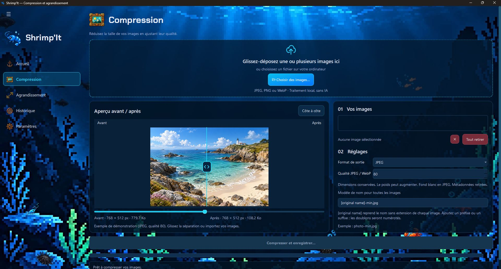
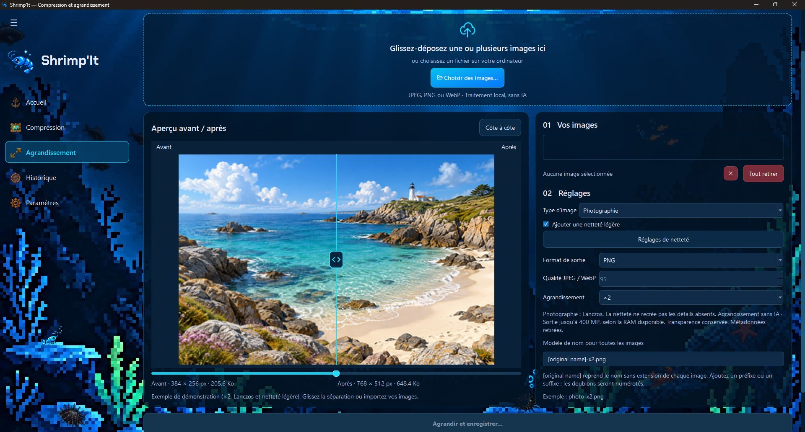

# Shrimp'It

[](https://github.com/AoHaneX/Shrimp-it/actions/workflows/checks.yml)

Application de bureau pour **compresser, convertir et agrandir des images localement**, avec une interface océanique en pixel art.

Projet personnel développé dans l’univers **ReefKit**, dans le cadre de mon parcours de développeur Python junior. Il me permet de travailler la séparation entre interface et traitement d’images, les tests et la distribution d’une application. Version actuelle : **1.1.0**, destinée à Windows.

Les traitements utilisent **Pillow**, sans modèle d’IA ni compte utilisateur. L’interface est construite avec **PySide6**. L’application fonctionne indépendamment des autres projets ReefKit.

## Fonctionnalités

### Compresser et convertir

Importez une ou plusieurs images, choisissez le format de sortie et comparez le résultat avant d’enregistrer. La compression conserve les dimensions de l’image.



Trois formats de sortie sont disponibles :

| Format | Fonctionnement et usage |
| --- | --- |
| **JPEG** | Pour les photographies : le réglage de qualité permet de trouver un compromis entre poids et détails. La transparence est remplacée par un fond blanc. |
| **PNG** | Pour conserver la transparence. Sans curseur de qualité : Shrimp'It choisit seul entre une palette de 256 couleurs, nettement plus légère, et l’encodage fidèle, selon le critère décrit ci-dessous. |
| **WebP** | Une autre possibilité pour réduire le poids, avec qualité réglable et conservation de la transparence. L’encodage utilisé ici est avec perte, comme pour le JPEG. |

Pour JPEG et WebP, diminuer la qualité peut alléger le fichier, mais aussi rendre la perte de détails visible. L’aperçu permet de choisir le compromis adapté à chaque image ; un fichier plus léger n’est pas garanti.

#### Compression PNG automatique

En compression, le format PNG compare trois encodages, entièrement en local avec Pillow :

1. **PNG fidèle** : les pixels normalisés, encodés sans perte et optimisés (le seul encodage des versions précédentes).
2. **PNG à palette** : 256 couleurs au maximum, opacité comprise. Une image qui contient déjà 256 couleurs ou moins est convertie sans aucune perte ; les autres sont réduites par l’octree rapide de Pillow, après avoir vidé la couleur cachée sous les pixels totalement transparents.
3. **PNG à couleurs réduites, opacité d’origine** : essayé quand la palette est refusée et que l’image a des pixels semi-transparents. Les couleurs sont réduites à 256, mais l’opacité de chaque pixel est recopiée telle quelle.

Une variante n’est retenue que si son fichier est plus léger que le PNG fidèle et si, une fois rouverte, elle garde les dimensions, laisse chaque pixel totalement transparent à 0 d’opacité et respecte tous les seuils suivants, mesurés après composition sur fond blanc **et** sur fond noir (le pire des deux compte) :

| Critère | Seuil | Rôle |
| --- | --- | --- |
| PSNR global | ≥ 34 dB | Écart moyen sur toute l’image |
| Pire bloc de 4 × 4 px | écart moyen ≤ 24 niveaux sur 255 | Détecte un petit contour perdu, invisible dans une moyenne globale |
| Faux contours | ≤ 1 % des pixels | Détecte les bandes : marche d’au moins 3 niveaux là où l’original varie d’au plus 1 |
| Bords semi-transparents | écart moyen ≤ 8, 99ᵉ centile ≤ 32 | Contours anticrénelés propres |

Sinon, le PNG fidèle est conservé. Le calcul est déterministe : l’aperçu et l’export font le même choix, affiché sous l’aperçu (« Encodage retenu ») et dans le détail de l’historique. L’agrandissement, y compris le mode Pixel Art, garde l’encodage fidèle.

Ces seuils ont été choisis à partir des essais ci-dessous (Pillow 13.0.0, Python 3.13, 6 novembre 2026). Les palettes retenues sont indiscernables de l’original à 200 % sur fond blanc et noir ; les palettes refusées montraient des bandes dans le ciel ou les dégradés, des taches de couleur, ou un pixel de fond devenu visible.

| Image | Taille | Fichier source | PNG fidèle | PNG automatique | Résultat |
| --- | --- | --- | --- | --- | --- |
| Mascotte transparente (`branding/shrimpy.png`) | 1185 × 1185 | 507 067 o | 409 907 o | **46 945 o** (−90,7 %) | Palette : 41,9 dB, pire bloc 20, faux contours 0,59 %, bords 3,8 / 18 |
| Icône transparente (`icons/settings.png`) | 256 × 256 | 92 412 o | 92 412 o | **21 247 o** (−77,0 %) | Palette : 34,8 dB, pire bloc 14, faux contours 0,31 %, bords 7,8 / 19 |
| Dégradé de couleurs synthétique | 512 × 512 | 5 936 o | 2 376 o | 2 376 o (−60,0 %) | Fidèle : la palette pèserait 10 054 o et crée 6,9 % de faux contours |
| Paysage photoréaliste (fond d’écran Windows `img102.jpg`, réduit et enregistré en PNG) | 1600 × 1000 | 1 117 810 o | 1 043 339 o | 1 043 339 o (−6,7 %) | Fidèle : la palette (163 964 o) crée 5,0 % de faux contours dans le ciel |
| Photographie de rue au téléphone (non versionnée) | 2064 × 1161 | 3 131 050 o | 2 954 969 o | 2 954 969 o (−5,6 %) | Fidèle : pire bloc 34 avec la palette |

Contrôles complémentaires : les quatre autres icônes passent en palette (de −73 à −76 %), la barre latérale transparente aussi (127 793 → 24 799 o) ; l’illustration d’exemple (palette à 30,3 dB) et le décor pixel art `ocean.png` (pire bloc 43, des couleurs rares disparaissent) restent fidèles. Une image transparente entourée d’un large halo flou, couverte par les tests, illustre la troisième variante : la palette rendait visibles des pixels de fond, la variante à opacité d’origine est retenue.

Limites observées :

- Les photographies et les dégradés restent presque toujours en PNG fidèle : sans tramage, 256 couleurs y créent des bandes. Pour ces images, JPEG ou WebP restent plus adaptés.
- Le quantificateur de Pillow est simple : sur certaines images, une palette plus soignée (par exemple avec libimagequant, absent des paquets Pillow pour Windows) serait acceptée là où Shrimp'It garde le PNG fidèle.
- Le choix encode et compare plusieurs variantes : sur une image de 25 MP, la compression PNG prend environ 6 à 7 s au lieu de 2 à 4 s, aperçu compris.
- Les seuils sont des mesures de pixels, pas une évaluation de la perception humaine ni de la gestion des couleurs.

### Agrandir sans IA

Choisissez un facteur **×2, ×3 ou ×4**, puis un mode adapté au contenu. Les modes Photographie et Illustration permettent aussi de saisir des dimensions personnalisées, avec conservation optionnelle des proportions.



| Mode | Méthode utilisée | À quoi sert-il ? |
| --- | --- | --- |
| **Photographie** | **Lanczos**, avec netteté supplémentaire réglable et désactivable | Agrandir les photos en recherchant un rendu naturel. Une netteté légère peut renforcer les contours ; trop de netteté peut les rendre artificiels. |
| **Illustration** | **Bicubic** par défaut, ou **Lanczos** au choix | Agrandir dessins, logos et aplats. Bicubic donne des transitions douces ; Lanczos peut rendre les contours plus marqués. Comparez les deux selon l’image. |
| **Pixel Art** | **Nearest Neighbor** — le plus proche voisin | Agrandir chaque pixel en un bloc de même couleur, sans lissage ni netteté ajoutée. Ce mode utilise les facteurs entiers ×2, ×3 ou ×4 et le format PNG. |

Ces algorithmes calculent une image plus grande à partir des pixels existants : ils ne recréent pas les détails absents de l’original.

### Outils communs

- **Import multiple** par sélection de fichiers ou glisser-déposer, pour les JPEG, PNG et WebP statiques.
- **Comparaison avant/après** avec séparation mobile (souris, curseur ou flèches du clavier) ou affichage côte à côte, dimensions et poids. Des exemples apparaissent lorsqu’aucune image n’est chargée.
- **Traitement par lots** avec progression, bilan et annulation après l’image en cours. Les conflits de noms sont numérotés pour préserver les fichiers existants.
- **Historique local** des 5 000 derniers exports réussis, avec miniatures et paramètres. Au-delà, les références les plus anciennes sont oubliées automatiquement. Supprimer une entrée ne supprime pas les images.
- **Paramètres** pour les valeurs par défaut, l’animation du menu, le son et les notifications de fin, selon leur disponibilité sous Windows.

### Nommer tout un lot

Le champ **« Modèle de nom pour toutes les images »** contient par défaut `[original name]-min.jpg` en compression ou `[original name]-x2.png` en agrandissement. Le marqueur `[original name]` reprend le nom de chaque image **sans son extension**.

Vous pouvez ajouter un préfixe ou changer le suffixe : `web-[original name]-final.png` donne par exemple `web-plage-final.png` et `web-montagne-final.png`. Le modèle s’applique à tout le lot, même si vous changez l’image sélectionnée. Un exemple du nom obtenu apparaît sous le champ.

Le suffixe par défaut suit le facteur choisi (`-x2`, `-x3`, `-x4`) ou les dimensions personnalisées. Un modèle personnalisé reste conservé lorsque le facteur change ; son extension s’adapte au format de sortie. Gardez cette extension dans le champ. Sans le marqueur, un nom commun est utilisé et les doublons sont numérotés. Les originaux ne sont jamais renommés.

## Installation et lancement

Sans Python : utilisez la version portable (`ShrimpIt-vX.Y.Z-Windows-Portable.zip`, à extraire puis lancer `ShrimpIt.exe`) ou l’installateur (`ShrimpIt-vX.Y.Z-Windows-Setup.exe`). Voir [Distribution Windows](docs/distribution-windows.md).

Depuis les sources, prérequis : **Windows 11**, **Python 3.11 ou supérieur** avec `pip`, et un accès Internet pour installer les dépendances. Les traitements fonctionnent ensuite localement.

Téléchargez ou clonez le dépôt, puis ouvrez PowerShell dans le dossier contenant `pyproject.toml` :

```powershell
py -m venv .venv
.\.venv\Scripts\python.exe -m pip install -e .
.\.venv\Scripts\python.exe -m shrimpit
```

L’activation de `.venv` n’est pas nécessaire avec ces commandes explicites. Pour les lancements suivants, seule la dernière commande est requise. Après un déplacement du projet, recréez l’environnement virtuel et réinstallez le projet au lieu de réutiliser une `.venv` copiée.

Les dépendances sont déclarées dans [`pyproject.toml`](pyproject.toml) : `Pillow>=13.0,<14`, `PySide6-Essentials` et `PySide6-Addons` (`>=6.8,<7`). Seuls ces deux paquets de PySide6 sont installés : le paquet complet `PySide6` ajouterait environ 300 Mo de modules inutilisés (Qt WebEngine, Qt Pdf). [`requirements-tested.txt`](requirements-tested.txt) conserve les versions directes d’une validation antérieure ; ce n’est pas un verrou complet des dépendances.

L’installation crée aussi `.venv\Scripts\shrimpit.exe`, qui lance l’application sans fenêtre de console : un raccourci vers ce fichier suffit pour les lancements suivants. Une version Windows autonome, utilisable sans Python, peut être construite comme décrit dans [Version Windows autonome](#version-windows-autonome).

## Limites à connaître

- Entrées limitées aux **JPEG, PNG et WebP statiques de 25 mégapixels maximum**. Les GIF et animations ne sont pas pris en charge.
- Sorties agrandies jusqu’à **400 MP**, sous réserve de mémoire disponible et des limites du format (16 383 pixels par côté en WebP, 65 500 en JPEG, y compris en compression). L’aperçu automatique ne calcule pas les sorties de plus de 25 MP ; en agrandissement PNG, il affiche un poids estimé, l’export final étant optimisé. La mémoire est vérifiée avant chaque grand export. Voir les [grands exports](docs/architecture.md#grands-exports).
- Une optimisation peut produire un fichier plus volumineux. L’agrandissement interpole les pixels et ne recrée pas les détails absents.
- JPEG et WebP sont encodés avec perte. En compression, PNG peut passer à une palette de 256 couleurs, donc légèrement modifier les pixels, uniquement si les critères de la [compression PNG automatique](#compression-png-automatique) sont respectés ; sinon, et toujours en agrandissement, PNG conserve les pixels après normalisation RGB/RGBA 8 bits. Les niveaux de gris 16 bits sont ramenés proportionnellement sur 8 bits. La transparence est conservée en PNG/WebP et remplacée par un fond blanc en JPEG.
- L’orientation EXIF est appliquée ; les métadonnées, GPS et profils ICC sont ensuite retirés. Cette version n’est pas destinée à un flux colorimétrique exigeant ou à la conservation des images haute profondeur.

Les originaux ne sont pas remplacés. Une erreur d’écriture gérée nettoie la sortie partielle, mais une interruption brutale du programme peut laisser un fichier incomplet.

## Développement et vérifications

Installer les outils de développement, puis lancer les contrôles de style et les tests :

```powershell
.\.venv\Scripts\python.exe -m pip install -e ".[dev]"
powershell -NoProfile -ExecutionPolicy Bypass -File .\scripts\check.ps1
```

Pour exécuter seulement les tests :

```powershell
.\.venv\Scripts\python.exe -m pytest -q
```

Les outils de sécurité sont facultatifs ; la recherche de vulnérabilités nécessite Internet :

```powershell
.\.venv\Scripts\python.exe -m pip install -e ".[audit]"
powershell -NoProfile -ExecutionPolicy Bypass -File .\scripts\security.ps1
```

Le [workflow Checks](.github/workflows/checks.yml) lance ces contrôles et Bandit sous Windows avec Python 3.11 et 3.13, puis installe la wheel construite dans un environnement vierge et lance son autotest. La recherche de vulnérabilités ([workflow Security audit](.github/workflows/security.yml)) tourne chaque lundi et peut être lancée à la main : une faille publiée dans une dépendance est signalée sans bloquer les autres modifications. Les actions GitHub sont épinglées par empreinte de commit ; Dependabot propose chaque semaine leurs mises à jour et celles des dépendances Python.

### Version Windows autonome

Une seule commande produit, dans `release\`, l’archive portable et l’installateur, qui embarquent Python et toutes les dépendances. Elle nécessite [Inno Setup 6](https://jrsoftware.org/isinfo.php) (`winget install JRSoftware.InnoSetup`) ; l’option `-SkipInstaller` ne produit que l’archive.

```powershell
powershell -NoProfile -ExecutionPolicy Bypass -File .\scripts\build_windows.ps1
```

Le script installe au besoin l’extra `build` dans `.venv`, puis lance `ShrimpIt.exe --self-test` sur l’archive extraite, sans Python dans le `PATH`. Outils, fichiers produits et préparation d’une nouvelle version : [Distribution Windows](docs/distribution-windows.md).

## Organisation et documentation

```text
src/shrimpit/        Moteur Pillow, historique et configuration
src/shrimpit/gui/    Fenêtre, pages, widgets et traitements en arrière-plan
src/shrimpit/assets/ Images, animations, son et police
tests/              Tests automatisés
scripts/            Vérification, préparation des exemples et construction Windows
packaging/          Recettes PyInstaller et Inno Setup
docs/               Architecture, distribution Windows et captures d’écran
```

L’[architecture et les choix techniques](docs/architecture.md) décrivent l’organisation du code, les modes d’agrandissement, les grands exports et le format de l’historique.

L’historique (`history.json`) et les journaux (`logs\`) sont enregistrés dans `%LOCALAPPDATA%\BlueShrimp\Shrimpit`, les préférences dans la clé de registre `HKEY_CURRENT_USER\Software\BlueShrimp\Shrimpit`. Supprimer ce dossier et cette clé remet l’application à zéro sans toucher aux images. Ces fichiers peuvent contenir des chemins personnels : ne les joignez pas publiquement sans les relire. Pour signaler un problème, indiquez la version de Shrimp'It (page Paramètres), la version de Python si vous lancez les sources, les étapes de reproduction, et utilisez une image non confidentielle.

## Pistes d’évolution

- Publication de l’archive portable et de l’installateur dans les GitHub Releases, compilés automatiquement par GitHub Actions.
- Préréglages expliqués (partage, site web, qualité élevée) avec estimation du poids.
- Redimensionnement vers une taille maximale, y compris la réduction.
- Import asynchrone pour les lots de plusieurs centaines d’images.
- Gestion des profils ICC et des images haute profondeur.

## Licence et ressources

Le **code source** est distribué sous la licence MIT. Le fichier [`LICENSE`](LICENSE) précise aussi ce qu’elle ne couvre pas.

Les **illustrations, mascottes, logos, icônes, fonds et animations propres à Shrimp'It et ReefKit** ont été créés par l’auteur du projet avec le générateur d’images d’OpenAI (ChatGPT, génération assistée par IA), pour cette application. L’application elle-même n’utilise aucune IA. Ces ressources, ainsi que les sons et les captures de `docs/images/`, sont exclues de la licence MIT : tous droits réservés, comme l’indique [`LICENSE`](LICENSE). Leur présence dans ce dépôt ou dans une version distribuée n’accorde pas d’autorisation de les réutiliser, modifier ou redistribuer. Toute réutilisation nécessite une autorisation écrite préalable.

Les ressources tierces restent soumises à leurs licences respectives. La licence de la police Chakra Petch est fournie dans `src/shrimpit/assets/licenses/` ; la provenance des exemples est décrite dans leur [documentation](src/shrimpit/assets/examples/README.md).
