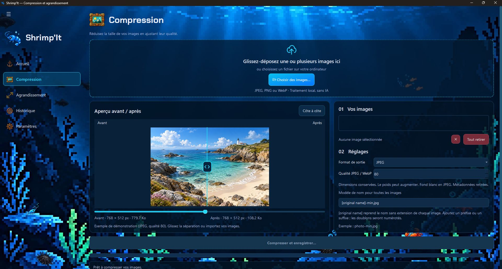
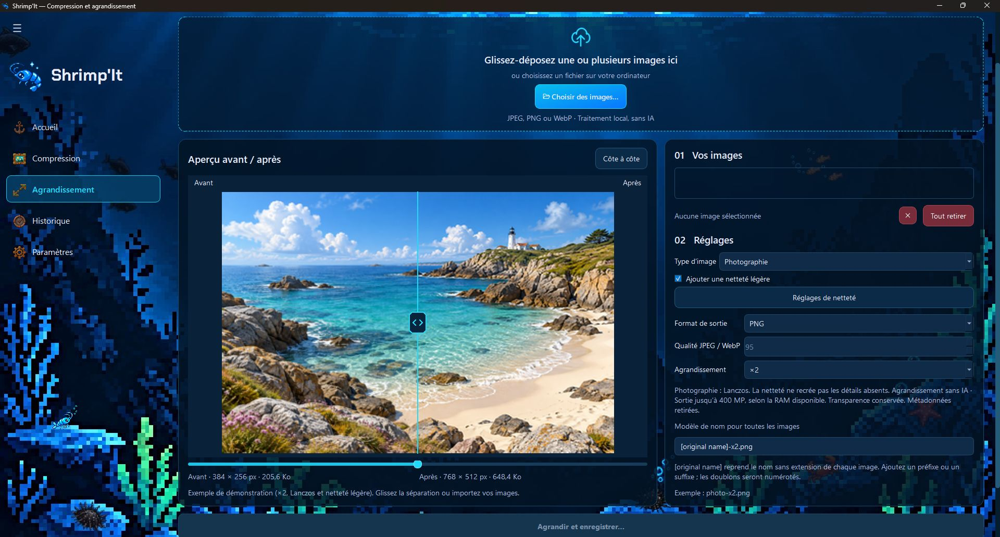

# Shrimp'It

Application de bureau pour **compresser, convertir et agrandir des images localement**, avec une interface océanique en pixel art.

Projet personnel développé dans l’univers **ReefKit**, dans le cadre de mon parcours de développeur Python junior. Il me permet de travailler la séparation entre interface et traitement d’images, les tests et la distribution d’une application. Version actuelle : **0.5.0**, destinée à Windows.

Les traitements utilisent **Pillow**, sans modèle d’IA ni compte utilisateur. L’interface est construite avec **PySide6**. L’application fonctionne indépendamment des autres projets ReefKit.

## Fonctionnalités

### Compresser et convertir

Importez une ou plusieurs images, choisissez le format de sortie et comparez le résultat avant d’enregistrer. La compression conserve les dimensions de l’image.



Trois formats de sortie sont disponibles :

| Format | Fonctionnement et usage |
| --- | --- |
| **JPEG** | Pour les photographies : le réglage de qualité permet de trouver un compromis entre poids et détails. La transparence est remplacée par un fond blanc. |
| **PNG** | Pour conserver la transparence et les pixels après la normalisation décrite plus bas. L’encodage est optimisé automatiquement, sans curseur de qualité. Le gain peut être faible si le fichier est déjà optimisé. |
| **WebP** | Une autre possibilité pour réduire le poids, avec qualité réglable et conservation de la transparence. L’encodage utilisé ici est avec perte, comme pour le JPEG. |

Pour JPEG et WebP, diminuer la qualité peut alléger le fichier, mais aussi rendre la perte de détails visible. L’aperçu permet de choisir le compromis adapté à chaque image ; un fichier plus léger n’est pas garanti.

### Agrandir sans IA

Choisissez un facteur **×2, ×3 ou ×4**, puis un mode adapté au contenu. Les modes Photographie et Illustration permettent aussi de saisir des dimensions personnalisées, avec conservation optionnelle des proportions.



| Mode | Méthode utilisée | À quoi sert-il ? |
| --- | --- | --- |
| **Photographie** | **Lanczos**, avec netteté supplémentaire réglable et désactivable | Agrandir les photos en recherchant un rendu naturel. Une netteté légère peut renforcer les contours ; trop de netteté peut les rendre artificiels. |
| **Illustration** | **Bicubic** par défaut, ou **Lanczos** au choix | Agrandir dessins, logos et aplats. Bicubic donne des transitions douces ; Lanczos peut rendre les contours plus marqués. Comparez les deux selon l’image. |
| **Pixel Art** | **Nearest Neighbor** — le plus proche voisin | Agrandir chaque pixel en un bloc de même couleur, sans lissage ni netteté ajoutée. Ce mode utilise les facteurs entiers ×2, ×3 ou ×4 et le format PNG. |

Ces algorithmes calculent une image plus grande à partir des pixels existants : ils ne recréent pas les détails absents de l’original.

### Outils communs

- **Import multiple** par sélection de fichiers ou glisser-déposer, pour les JPEG, PNG et WebP statiques.
- **Comparaison avant/après** avec séparation mobile (souris, curseur ou flèches du clavier) ou affichage côte à côte, dimensions et poids. Des exemples apparaissent lorsqu’aucune image n’est chargée.
- **Traitement par lots** avec progression, bilan et annulation après l’image en cours. Les conflits de noms sont numérotés pour préserver les fichiers existants.
- **Historique local** des exports réussis, avec miniatures et paramètres. Supprimer une entrée ne supprime pas les images.
- **Paramètres** pour les valeurs par défaut, l’animation du menu, le son et les notifications de fin, selon leur disponibilité sous Windows.

### Nommer tout un lot

Le champ **« Modèle de nom pour toutes les images »** contient par défaut `[original name]-min.jpg` en compression ou `[original name]-x2.png` en agrandissement. Le marqueur `[original name]` reprend le nom de chaque image **sans son extension**.

Vous pouvez ajouter un préfixe ou changer le suffixe : `web-[original name]-final.png` donne par exemple `web-plage-final.png` et `web-montagne-final.png`. Le modèle s’applique à tout le lot, même si vous changez l’image sélectionnée. Un exemple du nom obtenu apparaît sous le champ.

Le suffixe par défaut suit le facteur choisi (`-x2`, `-x3`, `-x4`) ou les dimensions personnalisées. Un modèle personnalisé reste conservé lorsque le facteur change ; son extension s’adapte au format de sortie. Gardez cette extension dans le champ. Sans le marqueur, un nom commun est utilisé et les doublons sont numérotés. Les originaux ne sont jamais renommés.

## Installation et lancement

Prérequis : **Windows 11**, **Python 3.11 ou supérieur** avec `pip`, et un accès Internet pour installer les dépendances. Les traitements fonctionnent ensuite localement.

Téléchargez ou clonez le dépôt, puis ouvrez PowerShell dans le dossier contenant `pyproject.toml` :

```powershell
py -m venv .venv
.\.venv\Scripts\python.exe -m pip install -e .
.\.venv\Scripts\python.exe -m shrimpit
```

L’activation de `.venv` n’est pas nécessaire avec ces commandes explicites. Pour les lancements suivants, seule la dernière commande est requise. Après un déplacement du projet, recréez l’environnement virtuel et réinstallez le projet au lieu de réutiliser une `.venv` copiée.

Les dépendances sont déclarées dans [`pyproject.toml`](pyproject.toml) : `Pillow>=13.0,<14`, `PySide6-Essentials` et `PySide6-Addons` (`>=6.8,<7`). Seuls ces deux paquets de PySide6 sont installés : le paquet complet `PySide6` ajouterait environ 300 Mo de modules inutilisés (Qt WebEngine, Qt Pdf). [`requirements-tested.txt`](requirements-tested.txt) conserve les versions directes d’une validation antérieure ; ce n’est pas un verrou complet des dépendances.

L’installation crée aussi `.venv\Scripts\shrimpit.exe`, qui lance l’application sans fenêtre de console : un raccourci vers ce fichier suffit pour les lancements suivants. Une version Windows autonome, utilisable sans Python, peut être construite comme décrit dans [Version Windows autonome](#version-windows-autonome).

## Limites à connaître

- Entrées limitées aux **JPEG, PNG et WebP statiques de 25 mégapixels maximum**. Les GIF et animations ne sont pas pris en charge.
- Sorties agrandies jusqu’à **400 MP**, sous réserve de mémoire disponible et des limites du format. L’aperçu automatique ne calcule pas les sorties de plus de 25 MP et la mémoire est vérifiée avant chaque grand export. Voir les [grands exports](docs/architecture.md#grands-exports).
- Une optimisation peut produire un fichier plus volumineux. L’agrandissement interpole les pixels et ne recrée pas les détails absents.
- JPEG et WebP sont encodés avec perte. PNG conserve les pixels après normalisation RGB/RGBA 8 bits ; les niveaux de gris 16 bits sont ramenés proportionnellement sur 8 bits. La transparence est conservée en PNG/WebP et remplacée par un fond blanc en JPEG.
- L’orientation EXIF est appliquée ; les métadonnées, GPS et profils ICC sont ensuite retirés. Cette version n’est pas destinée à un flux colorimétrique exigeant ou à la conservation des images haute profondeur.

Les originaux ne sont pas remplacés. Une erreur d’écriture gérée nettoie la sortie partielle, mais une interruption brutale du programme peut laisser un fichier incomplet.

## Développement et vérifications

Installer les outils de développement, puis lancer les contrôles de style et les tests :

```powershell
.\.venv\Scripts\python.exe -m pip install -e ".[dev]"
powershell -NoProfile -ExecutionPolicy Bypass -File .\scripts\check.ps1
```

Pour exécuter seulement les tests :

```powershell
.\.venv\Scripts\python.exe -m pytest -q
```

Les outils de sécurité sont facultatifs ; la recherche de vulnérabilités nécessite Internet :

```powershell
.\.venv\Scripts\python.exe -m pip install -e ".[audit]"
powershell -NoProfile -ExecutionPolicy Bypass -File .\scripts\security.ps1
```

Le [workflow GitHub Actions](.github/workflows/checks.yml) prévoit les contrôles sur Windows avec Python 3.11 et 3.13.

### Version Windows autonome

Le script de construction produit, dans `dist\`, une archive portable et un installateur qui embarquent Python et toutes les dépendances. Il nécessite [Inno Setup 6](https://jrsoftware.org/isinfo.php) pour l’installateur (`winget install JRSoftware.InnoSetup`) ; l’option `-SkipInstaller` ne produit que l’archive.

```powershell
.\.venv\Scripts\python.exe -m pip install -e ".[build]"
powershell -NoProfile -ExecutionPolicy Bypass -File .\scripts\build_windows.ps1
```

| Fichier | Usage |
| --- | --- |
| `Shrimpit-<version>-windows-x64-portable.zip` | À extraire n’importe où, puis lancer `Shrimpit\Shrimpit.exe`. Aucune installation. |
| `Shrimpit-<version>-windows-x64-setup.exe` | Installation pour l’utilisateur courant, sans droits administrateur, avec raccourci dans le menu Démarrer et désinstallation depuis les paramètres de Windows. |

Avant de créer l’archive, le script lance `Shrimpit.exe --self-test` sans Python dans le `PATH` : ressources, formats, modes d’agrandissement, police, animations, son et fenêtre principale sont vérifiés dans un dossier temporaire, sans toucher aux préférences ni à l’historique. Les empreintes SHA-256 des fichiers produits sont affichées à la fin.

## Organisation et documentation

```text
src/shrimpit/        Moteur Pillow, historique et configuration
src/shrimpit/gui/    Fenêtre, pages, widgets et traitements en arrière-plan
src/shrimpit/assets/ Images, animations, son et police
tests/              Tests automatisés
scripts/            Vérification, préparation des exemples et construction Windows
packaging/          Recettes PyInstaller et Inno Setup
docs/               Architecture et captures d’écran
```

L’[architecture et les choix techniques](docs/architecture.md) décrivent l’organisation du code, les modes d’agrandissement, les grands exports et le format de l’historique.

L’historique (`history.json`) et les journaux (`logs\`) sont enregistrés dans `%LOCALAPPDATA%\BlueShrimp\Shrimpit`, les préférences dans la clé de registre `HKEY_CURRENT_USER\Software\BlueShrimp\Shrimpit`. Supprimer ce dossier et cette clé remet l’application à zéro sans toucher aux images. Ces fichiers peuvent contenir des chemins personnels : ne les joignez pas publiquement sans les relire. Pour signaler un problème, indiquez la version de Shrimp'It (page Paramètres), la version de Python si vous lancez les sources, les étapes de reproduction, et utilisez une image non confidentielle.

## Pistes d’évolution

- Publication de l’archive portable et de l’installateur dans les GitHub Releases, compilés automatiquement par GitHub Actions.
- Préréglages expliqués (partage, site web, qualité élevée) avec estimation du poids.
- Redimensionnement vers une taille maximale, y compris la réduction.
- Import asynchrone pour les lots de plusieurs centaines d’images.
- Gestion des profils ICC et des images haute profondeur.

## Licence et ressources

Le **code source** est distribué sous la licence MIT. Le fichier [`LICENSE`](LICENSE) précise aussi ce qu’elle ne couvre pas.

Les **illustrations, mascottes, logos, icônes, fonds et animations propres à Shrimp'It et ReefKit** ont été créés par l’auteur du projet avec le générateur d’images d’OpenAI (ChatGPT, génération assistée par IA), pour cette application. L’application elle-même n’utilise aucune IA. Ces ressources, ainsi que les sons et les captures de `docs/images/`, sont exclues de la licence MIT : tous droits réservés, comme l’indique [`LICENSE`](LICENSE). Leur présence dans ce dépôt ou dans une version distribuée n’accorde pas d’autorisation de les réutiliser, modifier ou redistribuer. Toute réutilisation nécessite une autorisation écrite préalable.

Les ressources tierces restent soumises à leurs licences respectives. La licence de la police Chakra Petch est fournie dans `src/shrimpit/assets/licenses/` ; la provenance des exemples est décrite dans leur [documentation](src/shrimpit/assets/examples/README.md).
